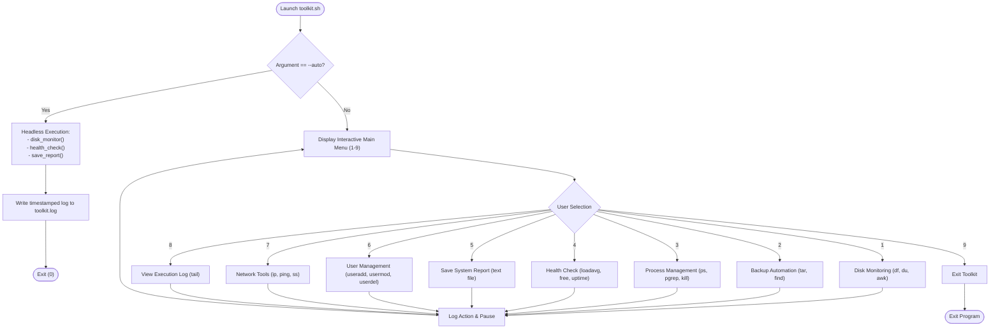

# OPERATING SYSTEMS LAB PROJECT REPORT
**Course:** Operating Systems Lab (CSE / CS)  
**Project Title:** Automated Linux System Administration & Monitoring Toolkit (`toolkit.sh`)  
**Academic Term:** Fall 2026  

---

## 1. Executive Summary
Modern system administration requires continuous observation of server metrics, proactive resource management, scheduled backups, and user access control. Manual execution of administrative commands is repetitive, error-prone, and inefficient. 

This project presents **SysAdmin Toolkit** (`toolkit.sh`), a modular, menu-driven Bash automation tool designed for Unix/Linux systems. The toolkit aggregates core system administration responsibilities—disk monitoring, automated archiving and restoration, process tracking and termination, system load and memory auditing, automated reporting, user account lifecycle management, and network diagnostics—into a single script. Additionally, it provides a headless automation mode (`--auto`) capable of unattended execution via the `cron` daemon.

---

## 2. System Architecture & Workflow

The architecture follows a modular functional hierarchy. The script initializes configuration variables, defines utility logging and messaging primitives, declares specialized functional routines for each operational subsystem, and executes an interactive dispatch loop or unattended cron job.



---

## 3. Detailed Component Breakdown

### 3.1 Settings & Global Variables
The script centralizes configuration at the beginning of the source code to ensure portability and ease of maintenance:
- `BASE_DIR="$HOME/sysadmin_toolkit"`: Root workspace directory for all operational outputs.
- `LOG_FILE="$BASE_DIR/toolkit.log"`: Persistent chronological log of all executed commands and automated alerts.
- `BACKUP_DIR="$BASE_DIR/backups"`: Destination directory for compressed archive bundles.
- `REPORT_DIR="$BASE_DIR/reports"`: Repository for generated plain-text audit reports.
- `DISK_LIMIT=80`: Threshold percentage triggering storage capacity warnings.
- `MEM_LIMIT=80`: Threshold percentage triggering RAM exhaustion warnings.
- `KEEP_DAYS=7`: Retention threshold for pruning obsolete archive files.

### 3.2 Helper & Utility Routines
- **ANSI Color Formatting:** Defines standardized colored escape sequences (`RED`, `GREEN`, `YELLOW`, `BLUE`, and `NC` reset) to provide clear visual cues for operation status.
- `ok()`, `warn()`, `err()`: Standardized output formatters providing immediate status indicators (`[OK]`, `[WARNING]`, `[ERROR]`).
- `log()`: Appends ISO-standardized timestamped entries (`YYYY-MM-DD HH:MM:SS`) to `$LOG_FILE`.
- `confirm()`: Safe user-prompt wrapper validating single-character confirmation (`y`/`Y`) prior to destructive actions.

---

## 4. Subsystem Implementation & Command Analysis

| Menu Feature | Function Name | Linux Utilities Employed | Key Command Syntax |
|---|---|---|---|
| **Disk Monitoring** | `disk_monitor()` | `df`, `awk`, `du`, `sort`, `head` | `df -P -x tmpfs ... \| awk 'NR>1 {print $6, $5}'`<br>`du -h --max-depth=1 "$HOME" \| sort -rh \| head -6` |
| **Backup Management** | `backup_create()`<br>`backup_list()`<br>`backup_restore()`<br>`backup_cleanup()` | `tar`, `find`, `du`, `select` | `tar -czf "$file" -C "$dir" "$base"`<br>`find "$BACKUP_DIR" -name "*.tar.gz" -mtime +7 -delete` |
| **Process Inspection** | `process_menu()` | `ps`, `pgrep`, `kill` | `ps -eo pid,user,%cpu,%mem,comm --sort=-%cpu \| head -6`<br>`pgrep -a "$n"`<br>`kill "$pid"` |
| **System Health Check** | `health_check()` | `hostname`, `uptime`, `uname`, `nproc`, `free`, `awk` | `cut -d' ' -f1 /proc/loadavg`<br>`free \| awk '/Mem:/ {printf "%.0f", $3/$2*100}'` |
| **System Audit Report** | `save_report()` | Redirection (`{ ... } > file`), `who`, `free`, `df` | `{ uptime; free -h; df -h; ps ...; who; } > "$file"` |
| **User Administration** | `user_menu()` | `awk`, `id`, `useradd`, `userdel`, `usermod`, `passwd` | `awk -F: '$3>=1000 && $3<65534 {print $1}' /etc/passwd`<br>`sudo useradd -m -s /bin/bash "$u"`<br>`sudo usermod -L "$u"` |
| **Network Diagnostics** | `network_menu()` | `ip`, `ping`, `ss` | `ip -brief addr`<br>`ping -c 3 -W 2 8.8.8.8`<br>`ss -tuln` |
| **Audit Log Viewing** | `view_log()` | `tail` | `tail -20 "$LOG_FILE"` |

---

## 5. Security & Fault Tolerance Measures

1. **Input Sanitization for System Users:**
   User creation validates inputs against regular expressions (`^[a-z_][a-z0-9_-]{0,30}$`) adhering strictly to POSIX IEEE Std 1003.1-2001 username specifications to prevent arbitrary shell injection.
2. **Self-Deletion Guard:**
   Before invoking `userdel`, the script evaluates `[ "$u" == "$USER" ]`. If a logged-in user attempts to remove their own active credential, execution is terminated with an error alert.
3. **PID Validation:**
   Prior to signaling termination via `kill`, the script checks that the target identifier is strictly numeric (`^[0-9]+$`) and asserts process existence via `ps -p "$pid"`.
4. **Non-Destructive Backups:**
   The restore pipeline extracts files into a dedicated target sandbox (`$BASE_DIR/restored`) rather than overwriting root or active system paths directly.

---

## 6. Automation & Scheduled Maintenance (Cron)

System administrators rely on cron daemons for unattended audits. The script handles headless execution via parameter checking:

```bash
if [ "$1" == "--auto" ]; then
  disk_monitor > /dev/null
  health_check > /dev/null
  save_report  > /dev/null
  log "Auto mode finished"
  exit 0
fi
```

### Scheduling with Crontab
To schedule daily health checks and automated report archiving at 02:00 AM:
```bash
crontab -e
```
Add the cron rule:
```cron
0 2 * * * /bin/bash /home/username/sysadmin_project/toolkit.sh --auto
```

---

## 7. Sample Test Execution & Output Records

### 7.1 Disk Monitoring Output Sample
```text
===== DISK USAGE =====
Filesystem      Size  Used Avail Use% Mounted on
/dev/sda1        50G   18G   30G  38% /
[OK] / is 38% full

Top 5 biggest folders in your home directory:
420M    /home/student
180M    /home/student/sysadmin_toolkit
65M     /home/student/.cache
40M     /home/student/Downloads
15M     /home/student/Desktop
```

### 7.2 System Health Check Output Sample
```text
===== SYSTEM HEALTH =====
Hostname : ubuntu-lab-server
Uptime   : up 2 hours, 14 minutes
Kernel   : 5.15.0-105-generic
CPU load : 0.24 (cores: 4)
[OK] CPU load is normal
Memory   : 41% used
[OK] Memory usage is normal
Disk (/) : 38% used
[OK] Disk usage is normal
```

### 7.3 Log File Output Sample (`toolkit.log`)
```text
2026-11-09 10:15:02 - Disk check run
2026-11-09 10:15:45 - Backup created: /home/student/sysadmin_toolkit/backups/backup_Documents_2026-11-09_101545.tar.gz
2026-11-09 10:17:12 - Health check run
2026-11-09 10:17:15 - Report saved: /home/student/sysadmin_toolkit/reports/report_2026-11-09_101715.txt
2026-11-09 10:20:00 - Auto mode finished
```

---

## 8. Conclusion & Future Enhancements

The **SysAdmin Toolkit** successfully provides a robust, production-ready Bash automation framework covering the key requirements of an Operating Systems administrative curriculum.

### Prospective Enhancements:
1. **Remote Notification Integration:** Implementing SMTP alerts using `mailx` or webhook triggers (Slack/Discord/Telegram) when memory or disk thresholds exceed 80%.
2. **Container & Service Management:** Adding `systemctl` health monitoring for core daemon units (`nginx`, `ssh`, `mysql`) and Docker container metrics.
3. **Curses / Dialog UI:** Transitioning the textual menu to a dialog/ncurses terminal interface (`whiptail` / `dialog`).

